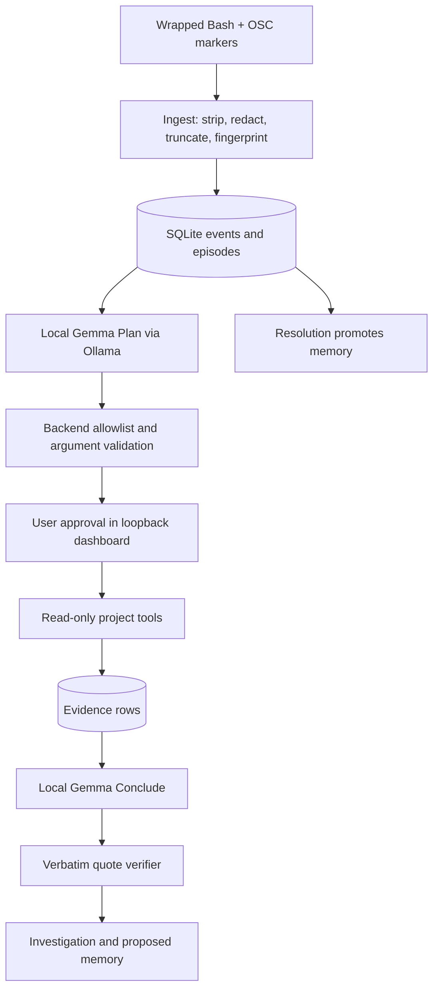

# Architecture

The Bash hook sends command start/end metadata through OSC 777 in the PTY byte stream. `MarkerParser` strips these control markers from terminal output and emits completed-command records. `ingest.py` removes ANSI sequences, redacts both command and output, bounds the excerpt, then computes a stable fingerprint.

`EpisodeManager` groups matching fingerprints within one session and resolves an open episode when the same command family later exits successfully. `OllamaBrain` sends Plan and Conclude calls to the local Ollama endpoint with JSON schemas. The backend validates each proposed tool name and its tool-specific arguments; approvals refer to stored proposal IDs rather than model-supplied authority.

Tools use argv lists with `shell=False`, a reduced environment, explicit Git overrides, fixed-string ripgrep, project-root checks, and content redaction. File reads record raw SHA-256 hashes so recalled memories can report changed paths. `verify.py` checks that each supporting quote occurs in the cited evidence and downgrades unsupported conclusions.

The dashboard is a static HTML file served by FastAPI on `127.0.0.1`. A random token is generated per launch and supplied in the URL fragment; the page sends it as a bearer token. The browser only reads events, investigations, and memories, and sends approve/reject/delete actions.
